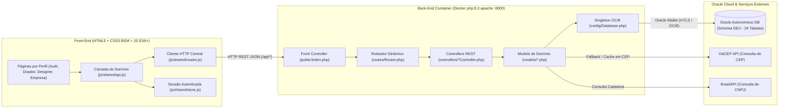
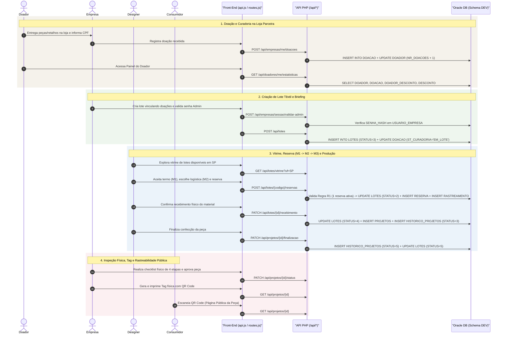
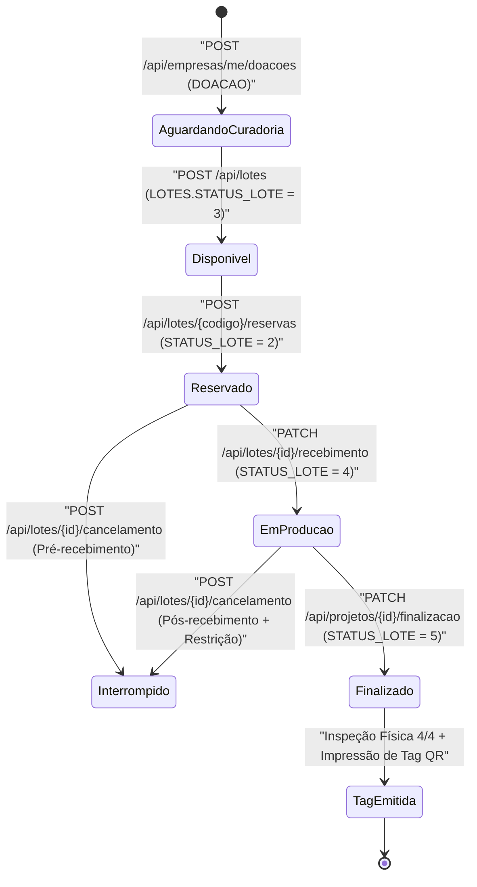
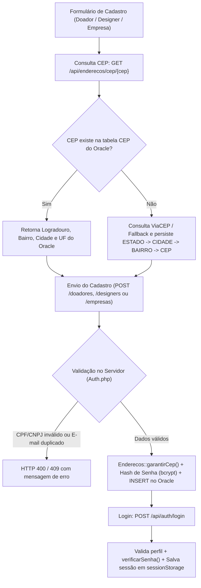

# Documentação de Arquitetura e Integração Full-Stack — CONTINUUM

> **Propósito:** Este documento consolida a arquitetura final do sistema **CONTINUUM**, detalhando a integração entre o **Front-End Vanilla (HTML5/CSS3/ES6+)** e a **API REST em PHP 8.2 Puro (OCI8)** conectada ao banco de dados **Oracle Cloud Autonomous Database (Schema `DEV`)**.

---

## 1. Visão Geral da Arquitetura

O sistema foi reestruturado para operar **100% conectado à API PHP e ao banco Oracle Cloud**, eliminando o banco simulado em `localStorage` (`mockApi` / `seed()`).



### Estrutura de Diretórios

* **Back-End (`/backend/src`)**
  * `config/Database.php`: Conexão Singleton via `oci_connect` com suporte a Oracle Wallet (`TNS_ADMIN`) e definição automática do schema (`ALTER SESSION SET CURRENT_SCHEMA = DEV`).
  * `routes/Router.php`: Roteador HTTP com suporte aos verbos `GET`, `POST`, `PUT`, `PATCH`, `DELETE`, precedência de rotas estáticas sobre rotas parametrizadas (`{id}` ou `:id`) e unificação de parâmetros de URL, query string e corpo JSON.
  * `public/index.php`: Ponto único de entrada da API, configuração de cabeçalhos CORS e registro das 44 rotas da aplicação.
  * `controllers/`: `AuthController.php`, `DoadoresController.php`, `DesignersController.php`, `EmpresasController.php`, `LotesController.php`, `ProjetosController.php`, `EnderecosController.php`, `SchemaController.php`.
  * `models/`: `Auth.php`, `Enderecos.php`, `Doadores.php`, `Designers.php`, `Empresas.php`, `Lotes.php`, `Projetos.php`, `Schema.php`.

* **Front-End (`/frontend`)**
  * `js/shared/routes.js`: Centraliza todas as definições de verbo HTTP, template de URL, serialização de payload, ocultação de segredos em `window.__CONTINUUM_LAST_REQUEST__` e execução de `fetch` contra `http://localhost:8000/api` (ou `window.CONTINUUM_API_URL`).
  * `js/shared/api.js`: Interface consumida pelas páginas, delegando 100% das chamadas assíncronas para `requestRoute()` e mantendo os helpers síncronos de sessão e permissão (`getSessaoAtual`, `logout`, `podeExecutar`, `verificarPermissaoEmpresa`).
  * `js/shared/store.js`: Contém apenas constantes de status e persistência da sessão autenticada em `sessionStorage` (`continuum_sessao`).

---

## 2. Diagramas dos Fluxos do Sistema

### 2.1. Fluxo Completo da Cadeia Circular (Doação → Lote → Reserva → Upcycling → Tag QR Code)



---

### 2.2. Máquina de Estados de Lotes e Projetos



---

### 2.3. Fluxo de Cadastro, Endereçamento (FK Segura) e Autenticação



---

## 3. Como Testar o Sistema

### 3.1. Subindo o Back-End (Docker)

```powershell
docker compose up -d
```

A API responderá em `http://localhost:8000/api`.

### 3.2. Servindo o Front-End

```powershell
cd frontend
python -m http.server 5500
```

Acesse `http://localhost:5500/lp.html` ou `http://localhost:5500/pages/auth/login/index.html`.

### 3.3. Contas de Teste no Banco Oracle (`DEV`)

| Perfil | Identificador (CPF / CNPJ / E-mail) | Senha | Nome no Banco Oracle |
| :--- | :--- | :--- | :--- |
| **Doador** | `11122233344` | `doador123` | Carlos Eduardo Silva (3 doações, 2 cupons) |
| **Doador** | `33344455566` | `pass789` | Roberto Alves (12 doações) |
| **Designer** | `12345678901` | `senha123` | Maria da Silva |
| **Designer** | `98765432100` | `pass456` | João Santos |
| **Empresa** | `12345678000190` ou `admin@loja.com` | `empresa123` | Têxtil Brasil (Assinatura Ativa) |
| **Empresa** | `98765432000110` | `empresa123` | Confecções Silva (Assinatura Ativa) |
